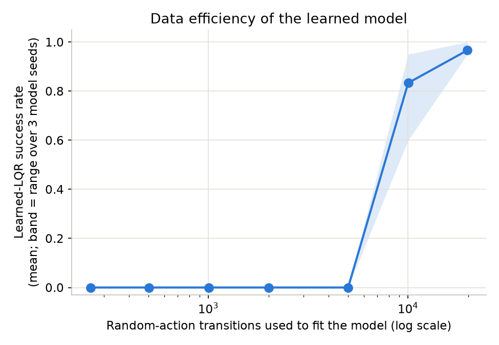
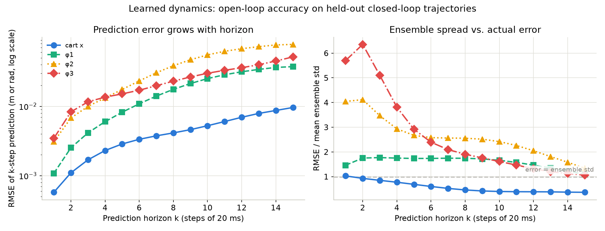
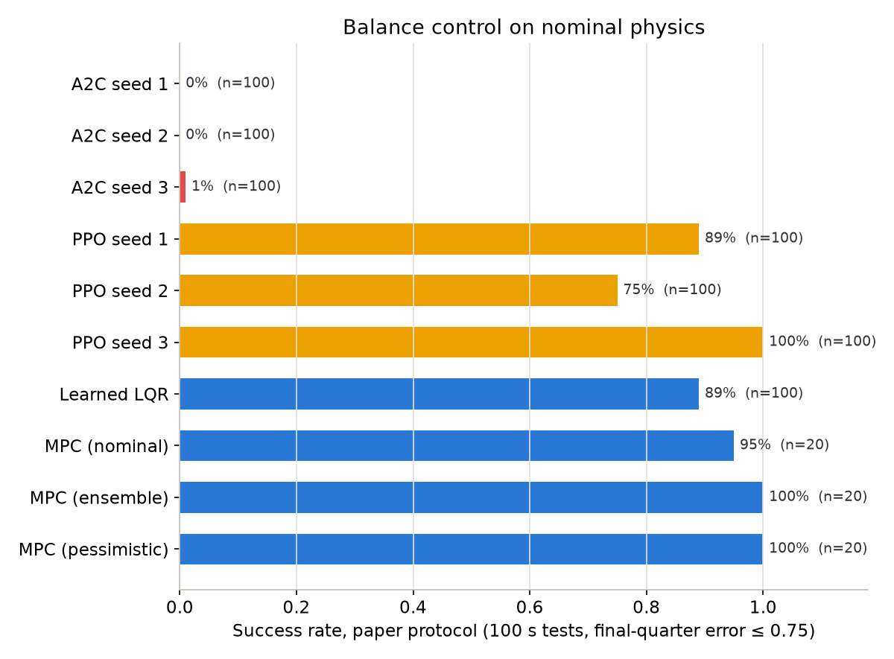
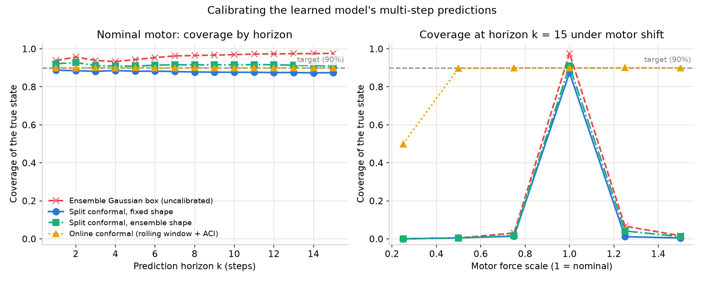
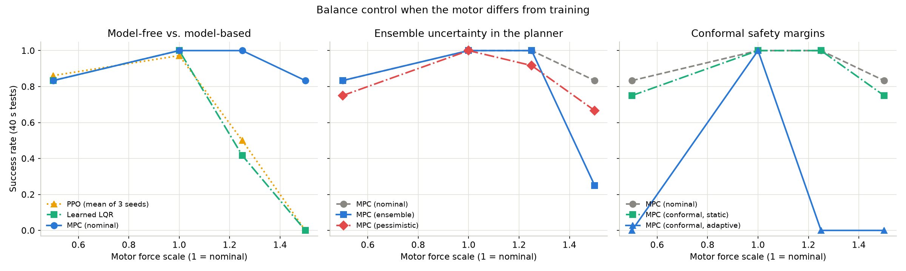

# Model-Based Control with Calibrated Dynamics

This document covers parts 2-4 of the project goal: a learned probabilistic
dynamics model, uncertainty-aware planning with it, and conformal calibration
of its predictions under distribution shift. Part 1 (model-free RL) is the
comparison baseline.

**Scope.** Everything here uses the paper-reproduction **balance** task
(`PAPER_REPRODUCTION.md`): a cart-mounted triple pendulum that starts within
±0.05 rad of upright, is pushed by bang-bang ±60 N cart forces at 50 Hz, and
fails when the cart leaves ±5.4 m or any relative angle leaves ±27°. Swinging
the pendulum up from hanging, the project's long-term goal, is **not** solved
here; these controllers are candidates for the balance stage of a future
swing-up-then-balance controller.

## Summary

| Question | Answer |
| --- | --- |
| Can a learned model replace RL training? | Yes, for balance. 19,825 random-action transitions (6.6 simulated minutes) give model-based controllers that match or beat PPO trained for 500,000 steps, and do so consistently. |
| Is the ensemble's own uncertainty trustworthy? | No. Depending on the data it over-covers or underestimates the error by up to 6×. |
| Does conformal calibration fix that? | On the training motor, yes (about 90%). Under a shifted motor, every offline region collapses to 0-7% coverage; online conformal (rolling window + ACI) holds 89.7-90.1% for motors from 0.5× to 1.5×. |
| Does uncertainty awareness make control more robust? | Not here. Plain MPC was the most robust controller under motor shift (83% success at 1.5× force, where PPO and learned LQR scored 0%). Ensemble and pessimistic planning did not help, and adaptive conformal margins made the planner fail by over-tightening its constraints. |

## Setup

**Test protocol.** Unless stated otherwise, tests use the paper protocol and
its initial states (seeds 10,000 + i): 5,000 steps (100 s), success if the
pendulum never fails and the final-quarter error
`max |[cart_x, phi_1, phi_2, phi_3]|` is at most 0.75. Motor-shift tests use
2,000 steps (40 s) and the same scoring.

**Distribution shift.** The cart force is scaled by 0.25-1.5× (a weaker or
stronger motor). Controllers and models are never told. A first sweep showed
that scaling all link masses, even 8×, barely affects any controller, so the
motor is the shift that matters.

**Baselines (part 1).** A2C and PPO with the paper's settings, 500,000 steps,
seeds 1-3 (`src/paper_reproduction/train_paper_triple_balance.py`).

## Part 2: Learned probabilistic dynamics

`src/model_based/dynamics.py` fits a bootstrapped ensemble of five Gaussian
MLPs (3 × 200 SiLU units) that predict the state change `s_{t+1} - s_t` from
`(s_t, u_t)`, trained by Gaussian negative log-likelihood (as in PETS, Chua et
al., 2018). Spread between members measures epistemic uncertainty. The
simulator is deterministic, so the aleatoric part is near zero.

**Data.** 2,000 episodes of uniformly random bang-bang actions from the
training reset (±0.1), which last about 10 steps each before falling: 19,825
transitions in total. Collecting them takes 0.5 s and fitting takes 13 s on CPU.



**Data efficiency.** Success of the learned-LQR controller (below) on 20
paper-style tests as the training set grows, for three model seeds:

| Transitions | ≤ 5,005 | 10,003 | 19,825 |
| --- | --- | --- | --- |
| Success (3 model seeds) | 0%, 0%, 0% | 95%, 95%, 60% | 95%, 95%, 100% |

There is a sharp threshold between 5k and 10k transitions. Below it, the
linearization is not accurate enough for the closed loop to be stable.



**Multi-step accuracy.** Open-loop predictions on held-out closed-loop
trajectories (learned LQR with 10% random actions):

| Horizon | cart x RMSE | phi_1 | phi_2 | phi_3 |
| --- | --- | --- | --- | --- |
| 1 step (20 ms) | 0.0006 m | 0.0011 rad | 0.0031 rad | 0.0035 rad |
| 15 steps (0.3 s) | 0.0096 m | 0.037 rad | 0.078 rad | 0.052 rad |

The ensemble's spread is a poor error bar. For the upper links it
underestimates the actual short-horizon error by 4-6× (right panel), while on
the planner's own trajectories (part 4) the same ensemble's Gaussian boxes
*over*-cover (94-98% against a 90% target). This motivates calibrating it.

## Part 3: Model-based control

`src/model_based/mpc.py` builds two kinds of controller on the learned model.

**Learned LQR.** Linearize the ensemble-mean dynamics at upright (the force
enters affinely, so the drift at zero force is the average of the predictions
at ±60 N), solve the discrete Riccati equation, and apply `u = sign(-K s)`.
The learned linearization's largest open-loop eigenvalue is 1.23 per step, an
error-doubling time of 67 ms, which shows how unstable the system is.
Converting the linear command into on/off pushes by sigma-delta modulation
failed completely (0/20), while the plain sign rule works.

**Model-predictive control (MPC).** Every step, sample 128 *closed-loop*
candidate plans `u_k = sign(-K s_k + n_k)` (the learned-LQR policy with
perturbations), roll them out 15 steps (0.3 s) through the model, score them
by a quadratic state cost plus a penalty for predicted failures plus the LQR
cost-to-go, refine the perturbations with two cross-entropy-method iterations,
and apply the first action. Starting from a good policy is what made planning
work: an earlier planner that searched blindly over 25-step on/off sequences
fell within 1 s. Variants differ only in how uncertainty enters the score:

- **nominal**: one rollout through the ensemble mean
- **ensemble**: each member rolls the plan out; costs averaged (PETS-style)
- **pessimistic**: ensemble mean cost + 1 × std of the cost across members
- **conformal**: nominal, with failure bounds tightened by calibrated margins (part 4)

Planning takes 20 ms per step on one core, which is real time at 50 Hz.



| Controller | Data / training | Tests | Success |
| --- | --- | --- | --- |
| A2C, seeds 1 / 2 / 3 | 500k steps each | 100 each | 0% / 0% / 1% |
| PPO, seeds 1 / 2 / 3 | 500k steps each | 100 each | 89% / 75% / 100% |
| Learned LQR | 19,825 random transitions | 100 | 89% |
| MPC (nominal) | same model | 20 | 95% |
| MPC (ensemble) | same model | 20 | 100% |
| MPC (pessimistic) | same model | 20 | 100% |

**Reproduction note.** The paper reports that 500k steps suffice for A2C. Here
A2C failed for all three seeds, while PPO succeeded but varied strongly
between seeds (75-100%). That variability is the paper's own theme, the
reliability of RL for mechanical systems, and it is where the model-based
controllers differ most: they are built from 25× less data and do not depend
on a lucky training seed.

## Part 4: Conformal calibration under distribution shift

### Calibrating multi-step predictions

`src/model_based/conformal_dynamics.py` builds prediction boxes for the state
k = 1..15 steps ahead. For a start state and the actions actually applied, the
score is the largest normalized error over the constraint coordinates
`[cart_x, phi_1, phi_2, phi_3]`:

```text
S_k = max_d |s_{t+k,d} - s_hat_{t+k,d}| / scale_{k,d}
```

Split conformal prediction turns calibration scores into a radius `q_k` such
that the box `s_hat ± q_k * scale_k` contains the true state with probability
at least 90% when calibration and test trajectories are exchangeable.
Calibration and test data are closed-loop runs of nominal MPC (12 calibration
episodes on the training motor, 6 test episodes per motor). Coverage is
calibrated separately at each horizon, not simultaneously over all 15.

Four regions are compared:

- **Ensemble Gaussian**: `s_hat ± z * ensemble std`, uncalibrated
- **Split conformal, fixed shape**: scale = calibration error std per horizon and coordinate
- **Split conformal, ensemble shape**: scale = the ensemble's own std (adaptive width)
- **Online conformal**: fixed shape, with each `q_k` updated during the episode
  from a rolling window of the last 50 scores plus adaptive conformal inference
  (Gibbs & Candès, 2021; step size 0.05). This is the combination that worked
  best in the Conformal-Risk-Prediction project.



Coverage at horizon 15 (0.3 s ahead):

| Motor force | Ensemble Gaussian | Conformal (fixed) | Conformal (ensemble) | Online conformal |
| --- | --- | --- | --- | --- |
| 1.0× (training) | 97.6% | 87.5% | 90.9% | 90.0% |
| 0.5× | 0.4% | 0.5% | 0.4% | 89.7% |
| 0.75× | 3.1% | 1.3% | 1.7% | 89.9% |
| 1.25× | 6.6% | 1.1% | 4.1% | 90.1% |
| 1.5× | 1.7% | 0.4% | 1.1% | 89.9% |

The pattern is the same at every horizon from 1 to 15. On the training motor,
split conformal lands near target; the fixed-shape version is slightly under
(87.5-88.8%), most likely because consecutive states within an episode are
correlated, so exchangeability only really holds between whole episodes, and
there are only 12 calibration episodes.

Under any motor shift, every offline region collapses to 0-7% coverage, even
one step ahead. The model is so precise (one-step angle box ±0.001 rad) that a
25% change in force already puts the true state outside. Online conformal
holds 89.7-90.1% for every shift from 0.5× to 1.5×. At 0.25× the controller
falls almost immediately, leaving 20-103 scored predictions per horizon, too
few to evaluate.

### Control under motor shift

Twelve 40 s tests per controller and motor (PPO: 12 per seed).



| Controller | 0.5× | 1.0× | 1.25× | 1.5× |
| --- | --- | --- | --- | --- |
| PPO, seeds 1 / 2 / 3 | 92 / 75 / 92% | 100 / 92 / 100% | 33 / 25 / 92% | 0 / 0 / 0% |
| Learned LQR | 83% | 100% | 42% | 0% |
| MPC (nominal) | 83% | 100% | 100% | **83%** |
| MPC (ensemble) | 83% | 100% | 100% | 25% |
| MPC (pessimistic) | 75% | 100% | 92% | 67% |
| MPC (conformal, static margins) | 75% | 100% | 100% | 75% |
| MPC (conformal, adaptive margins) | **0%** | 100% | **0%** | **0%** |

With 12 tests per cell, differences smaller than about 25 percentage points
are within noise.

- **A weaker motor** (0.5×) degrades every controller similarly, to 75-92%.
- **A stronger motor** separates them. Bang-bang pushes that are 25-50% too
  strong overshoot. PPO and learned LQR, which map state to action with no
  model of the consequences, collapse to 0% at 1.5×. MPC replans every 20 ms
  from the measured state, so feedback corrects much of the model error: plain
  MPC still succeeds 83% of the time at 1.5×.
- **Ensemble uncertainty did not help.** Pessimistic and static-conformal
  planning are statistically indistinguishable from nominal MPC, and ensemble
  averaging was clearly worse at 1.5×. The ensemble was trained on one motor,
  so all members share the same wrong force effect; their disagreement does
  not measure this error.
- **Adaptive conformal margins made the planner fail**, even though the same
  online calibration achieved its 90% coverage target. See the diagnostic below.

### Diagnostic: why adaptive margins failed

Under a shifted motor the model's k-step errors are tens of times larger than
on the training motor. The online calibration correctly grows the margins to
match, often past the failure limits themselves. Infinite margins are
harmless: every candidate plan then "violates" equally and the penalty drops
out. Large but *finite* margins are not. They leave a tightened safe region
only a few degrees wide, the failure penalty dominates the score, and the
planner chooses aggressive pushes that keep the *predicted* angles inside that
sliver instead of stabilizing the real pendulum.

To test this, the same adaptive controller was rerun with each margin capped
at half the failure limit (a post-hoc diagnostic with the same 12 tests, not a
tuned result; `stage_diagnostic` in `experiments.py`):

| Motor force | Adaptive margins | Adaptive, capped at 50% of limit | Nominal MPC |
| --- | --- | --- | --- |
| 0.5× | 0% | 67% | 83% |
| 1.25× | 0% | 100% | 100% |
| 1.5× | 0% | 50% | 83% |

Capping removes the collapse, which confirms over-tightening as the cause, but
it still does not beat plain MPC. The lesson mirrors the Conformal-Risk-Prediction
project, where weighted conformal prediction stayed valid under strong shift
by returning infinite intervals: **a calibrated region can be valid and still
useless for decisions.** Under heavy model mismatch, the honest region is
large, and using it as a hard constraint throws away the controller's
ability to act. Calibration is better used here to *detect* that the model
is wrong (online coverage drops immediately when the motor changes) than as
a safety margin.

## Other findings

- **The environment's reward uses a stale tip position.** MuJoCo updates site
  positions at the start of `mj_step`, before integrating, and the environment
  does not refresh them afterwards, so `tip_x` in the reward and `info` lags
  the state by one step (about 0.004 m). The effect on the reward is under
  0.4%, so the baselines were left unchanged.
- **requirements.txt was saved as UTF-16**, which `pip install -r` cannot read
  on macOS or Linux. It is now UTF-8, and `scipy` and `pandas` were added.

## Limitations

- Balance only; no swing-up.
- One kind of shift (motor strength), one learned model, and one random-data
  collection. The ensemble's calibration is likely to depend on how its
  training data were collected.
- MPC variants were run on 20 nominal tests and 12 shifted tests per cell
  (compared with 100 for the cheap controllers), so small differences between
  MPC variants are not significant.
- The MPC minimizes a quadratic deviation from upright plus a failure penalty,
  not the paper's reward; all controllers are scored on the same paper
  protocol.
- The model is never updated during deployment. Learning from the new
  transitions online would address the motor shift at its source, rather than
  only measuring it.
- Conformal guarantees are per horizon, and exchangeability between closed-loop
  trajectories is approximate.

## Next steps

1. **Swing-up.** Train or plan a swing-up controller and hand over to one of
   these balance controllers near upright.
2. **Online model adaptation.** Refit the model on recent transitions so a
   changed motor is learned, not just detected; use the online conformal
   coverage as the trigger.
3. **Use calibrated uncertainty without over-tightening**, e.g. soft
   constraints with bounded penalties, or margins that switch to a safe
   fallback controller when the calibrated region becomes too large.

## Reproducing

```bash
.venv/bin/python src/model_based/run_all.py              # data, model, control, coverage, shift, plots
```

Stages cache their outputs; see the module docstrings in `src/model_based/`.
Closed-loop tests run in parallel (7 workers) and resume if interrupted. On an
Apple M3 laptop the full run takes about 2 hours of awake time, mostly the
planner tests.

## References

- Manzl et al. Reliability evaluation of reinforcement learning methods for
  mechanical systems with increasing complexity.
  https://doi.org/10.1007/s11044-023-09960-2
- Chua, K., Calandra, R., McAllister, R., Levine, S. (2018). Deep reinforcement
  learning in a handful of trials using probabilistic dynamics models. *NeurIPS*.
- Gibbs, I., Candès, E. (2021). Adaptive conformal inference under
  distribution shift. *NeurIPS*.
